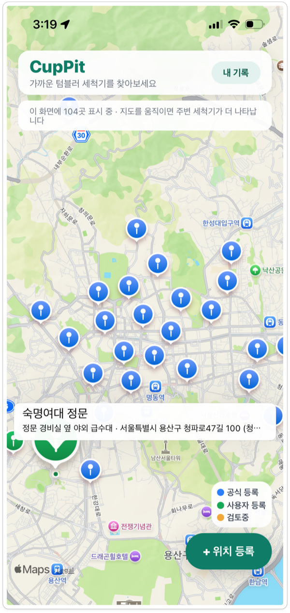
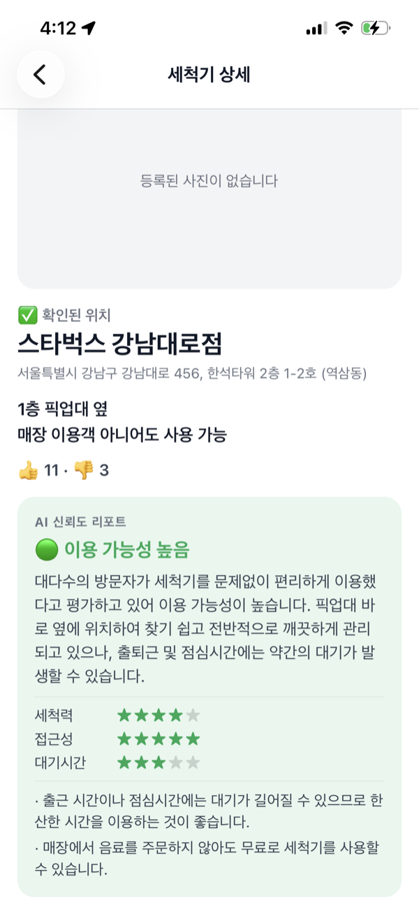
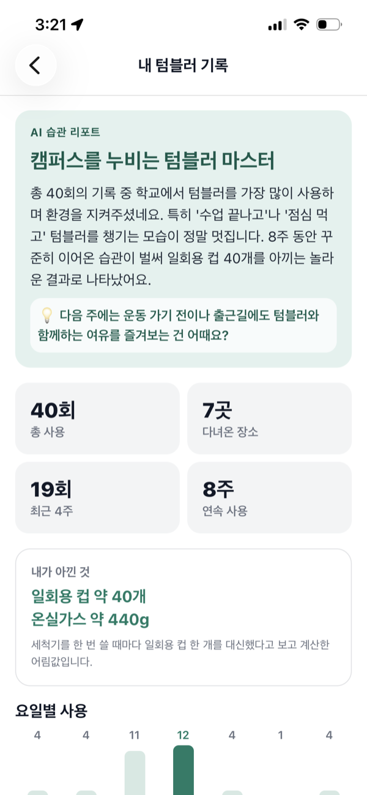

# CupPit

> 텀블러를 안 쓰는 이유는 깜빡해서가 아니라, 씻는 게 귀찮아서다.
흩어진 텀블러 세척기 위치를 지도로 모으고, AI가 지금 이용 가능한지 알려주는 앱.

### 이름의 유래

**Cup + Pit** 레이싱카가 경기 도중 잠깐 들러 정비를 받고 다시 달리는 곳이 피트스톱이다.
텀블러도 하루 중 잠깐 들러 씻고 다시 쓰면 된다. `Pit`에는 *자리·거점*이라는 뜻도 있어서,
흩어져 있던 세척기를 한 지도 위의 거점으로 모은다는 의미도 담았다.

---

## 프로젝트 소개 (바이브톤 해커톤)

- **행사**: 멋쟁이사자처럼 AI 바이브톤 (2026.9.3)
- **주제**: 불편함을 해결하는 AI 서비스 (환경 카테고리)
- **팀**: 7조, 5인 (발표 2인, 개발 3인)

| 지도 | AI 신뢰도 리포트 | 내 텀블러 기록 |
| :--: | :--: | :--: |
|  |  |  |

---

## 문제 정의

텀블러 사용을 권장하는 캠페인은 많지만, 실제로 사람들이 텀블러를 안 쓰는 가장 흔한 이유는 세척이 번거로워서다.

LG전자의 무료 세척기 마이컵(myCup)이 이미 설치되어 있지만:

- 설치 위치가 흩어져 있고, LG전자 이외의 타 브랜드 등 통합된 정보가 없다.
- 대표 브랜드 앱을 찾아봐도 안 나오는 세척기가 실제로 존재한다

**CupPit은 어디에 세척기가 있고, 지금 쓸만한지를 알려주는 정보 레이어를 채운다.**

---

## 핵심 기능

1. **통합 지도** — 파악된 세척기 위치 + 사용자 등록 위치를 함께 표시하고, 신뢰 단계를 색으로 구분
2. **위치 등록** — 지도에서 좌표를 찍으면 주소 자동 입력. 사진·상세 설명은 선택(등록 문턱을 낮춤)
3. **리뷰 (👍/👎 + 태그)** — 실사용자 피드백 축적
4. **AI 신뢰도 리포트** — 리뷰 텍스트를 Gemini(`gemini-3.1-flash-lite`)가 요약해 "지금 이용 가능 확률"과 항목별 점수 제공
5. **등록 사진 검증** — 올린 사진에 세척 설비가 있는지 같은 모델의 비전 기능으로 확인
6. **비속어 필터** — 금칙어 목록 기반 규칙 검사 (AI 아님)
7. **내 텀블러 기록** — 사용 기록에서 계산한 습관 통계 + AI 응원 문구
8. **신고 & 관리** — Django Admin에서 허위/부적절 등록 검토·삭제
9. **인프라 공백 리포트** *(예정)* — 사용자 동선 대비 세척기 부족 지역 데이터화 (지자체 제안 자료로 확장 가능)

---

## 앱 화면

| 경로 | 화면 | 하는 일 |
| --- | --- | --- |
| `/` | 지도 | 주변 세척기를 신뢰 단계별 색으로 표시. 보이는 범위만 그려 마커가 많아도 버팀 |
| `/location/[id]` | 세척기 상세 | 사진·위치 안내·👍/👎 집계 + **AI 신뢰도 리포트** + 리뷰 목록 |
| `/add-location` | 위치 등록 | 좌표 찍기 → 주소 자동 입력 → 건물명 → 사진(선택) → 상세 설명(선택) |
| `/review/[id]` | 리뷰 작성 | 👍/👎 선택 후 태그 + 100자 이내 의견 |
| `/record/[id]` | 사용 기록 남기기 | 달력에서 씻은 날짜·시간 선택 + 상황 메모 |
| `/my-report` | 내 텀블러 기록 | 사용 패턴 통계 + **AI 습관 리포트** |

---

## 위치를 어떻게 믿게 하나

누구나 등록할 수 있게 하면 정보가 빨리 모이지만 틀린 정보도 같이 모인다.
등록을 막는 대신 **믿을 수 있는 정도를 눈에 보이게** 했다. 지도 마커 색과 상세 화면 안내가 한 세트로 움직인다.

| 마커 | 상태 | 뜻 |
| --- | --- | --- |
| 🔵 파랑 | 공식 등록 | 운영진이 확인했거나 브랜드가 공개한 위치 |
| 🟢 초록 | 사용자 등록 | 사용자가 올렸고 운영진 확인까지 끝난 위치 |
| 🟡 노랑 | 확인 전 · 신고 검토중 | 아직 검증 안 됨. 상세 화면에 주의 안내가 함께 뜬다 |

앱으로 등록한 위치는 항상 `unconfirmed`(확인 전)으로 들어간다.
신고가 접수되면 자동으로 `reviewing`으로 바뀌고, 관리자가 Admin에서 `removed`로 바꾸면 목록 API에서 빠진다.
행은 남고 앱에서만 사라지는 **소프트 삭제**라 되돌릴 수 있다.

---

## 기술 스택

**Frontend**: React Native 0.81 (Expo SDK 54), TypeScript, expo-router,
react-native-maps, expo-image-picker, expo-location, @react-native-community/datetimepicker

**Backend**: Django 6.1, Django REST Framework, SQLite, django-cors-headers, Pillow

**AI**: Google Gemini (`gemini-3.1-flash-lite`, `.env`의 `GEMINI_MODEL`로 변경 가능)

---

## 시스템 아키텍처

```
[Expo 앱] --REST API--> [Django/DRF] --읽기/쓰기--> [SQLite DB]
                              │                          ↑
                              │                     [Django Admin]
                              └──워커/필요 시 호출──> [Gemini]
```

신뢰도 리포트는 백그라운드 워커가 미리 계산해 저장하고, 조회 API는 그 값을 즉시 읽는다.
사진 검증과 사용 리포트 문구만 필요한 시점에 Gemini API를 호출하며, 결과는 캐시해서 재사용한다.
API 키가 없거나 호출이 실패해도 규칙 기반 폴백으로 항상 응답이 나간다.
신고 관리는 별도 화면 없이 Django Admin으로 처리.

---

## AI를 어디에 쓰고, 어디엔 안 쓰는가

| 기능 | AI 사용 | 이유 |
| --- | --- | --- |
| 지도 표시 | ❌ | 단순 데이터 시각화 |
| 위치 등록 | ❌ | 사용자 직접 입력 |
| **리뷰 요약 + 신뢰도 판단** | ✅ | 정형 태그로 못 잡는 패턴을 자연어에서 추출 |
| **리뷰 항목별 점수** | ✅ | 리뷰에 언급된 항목만 추려 별점화 (없는 항목은 비움) |
| **등록 사진 검증** | ✅ | 세척 설비인지 판단하려면 이미지 이해가 필요 |
| 비속어 필터 | ❌ | 금칙어 목록으로 충분하고, 즉시·무료·결과가 일정 |
| 사용 통계 계산 | ❌ | 숫자는 `stats.py`가 실제 기록으로 계산 — 틀리면 안 되는 값 |
| **사용 리포트 문구** | ✅ | 계산된 통계를 사람이 읽을 문장으로 풀어쓰는 역할만 |
| **인프라 공백 리포트** *(확장시 예정)* | ✅ | 동선 데이터와 위치 데이터의 교차 패턴 분석 |
| 신고 처리 | ❌ | 최종 삭제는 관리자가 판단 |

---

## 실행 방법 (로컬)

### 요구 사항

- Python 3.12 이상
- Node.js 18 이상
- uv (파이썬 패키지 매니저)

### Backend
```bash
cd washmycup-backend
uv venv --python 3.12 venv
source venv/bin/activate
uv pip install -r requirements.txt
cp .env.example .env              # GEMINI_API_KEY, DJANGO_SECRET_KEY 채우기
python manage.py migrate
python manage.py seed_locations --with-reviews --with-usages   # 위치 12곳 + 리뷰 125건 + 사용 기록 40건
python manage.py createsuperuser  # Django Admin 계정
python manage.py runserver
```

- API: http://127.0.0.1:8000/api/locations/
- 관리자(신고 목록): http://127.0.0.1:8000/admin/locations/report/

**AI 신뢰도 리포트 워커** (별도 터미널에서 실행):
```bash
python manage.py update_reliability
```
60초마다 DB를 확인해서, 새 리뷰가 3개 이상 몰린 위치는 즉시, 아니면 리뷰가 생긴 지
5분이 지난 위치를 재계산한다(기본값, `--poll-interval`/`--review-threshold`/`--min-interval`로 조정 가능).
`/reliability/` 엔드포인트는 이 워커가 채워둔 값만 읽는다 — 요청 시점엔 Gemini를 호출하지 않아
동시접속자가 많아도 응답이 느려지지 않는다. 데모 직전 강제로 한 번 갱신하려면
`python manage.py update_reliability --once`.

### Frontend
```bash
cd washmycup-app
npm install
npx expo start
# 폰의 Expo Go 앱으로 터미널의 QR 코드 스캔 (맥과 같은 와이파이)
```

> **Expo SDK 54 고정** — 앱스토어/플레이스토어의 Expo Go가 SDK 54에 머물러 있어서,
> 스토어에서 받은 Expo Go로 QR을 찍으려면 프로젝트도 SDK 54여야 합니다.
> Expo Go의 제작사는 `650 Industries, Inc.`입니다.
>
> **모르는 사람이 보낸 Expo Go QR/링크는 절대 열지 마세요.** Expo Go는 QR이 가리키는
> 코드를 그대로 실행하는 도구라, 이를 악용해 연락처·사진을 빼가는 피싱 수법이 있습니다.
> 내 개발 서버가 띄운 QR을 찍는 것은 안전합니다.

백엔드 주소는 Expo 개발 서버 주소에서 자동으로 유도되므로(`src/constants/config.ts`),
시뮬레이터든 실물 폰이든 따로 고칠 필요가 없습니다.

`.env` 파일에 `GEMINI_API_KEY` 설정 필요 (`.env.example` 참고)

---

## API 엔드포인트

| Method | 경로 | 설명 |
| --- | --- | --- |
| GET | `/api/locations/` | 위치 목록 (삭제됨 제외, 👍/👎 집계 포함) |
| POST | `/api/locations/` | 위치 등록 (multipart, 사진·상세설명은 선택) |
| GET | `/api/locations/{id}/` | 위치 상세 + 리뷰 목록 |
| GET·POST | `/api/locations/{id}/reviews/` | 리뷰 조회 / 작성 |
| GET | `/api/locations/{id}/reliability/` | AI 신뢰도 리포트 `{score, summary, aspects, notes}` |
| POST | `/api/locations/{id}/report/` | 신고 등록 (처리는 Django Admin) |
| POST | `/api/locations/{id}/usages/` | 사용 기록 (`used_at`, `note` 선택 — 지난 시각도 가능) |
| GET | `/api/usages/` | 사용 기록 목록 |
| DELETE | `/api/usages/{id}/` | 사용 기록 삭제 (잘못 남긴 기록 되돌리기) |
| GET | `/api/usages/notes/` | 전에 적은 상황 문구 (최신 8개) |
| GET | `/api/me/report/` | 내 사용 기록 리포트 `{stats, narrative}` |

신고가 접수되면 해당 위치는 `reviewing` 상태로 바뀌고, 관리자가 Admin에서 `removed`로 바꾸면 목록 API에서 사라진다.

---

## 향후 확장 방향

- **로그인** — 지금은 기기 하나가 곧 한 사람이다. 계정이 붙어야 기록이 개인별로 나뉜다.
- **중복 등록 감지** — 좌표 근접도로 1차 필터링 후 이름·사진 비교
- **AI 요약 백그라운드 갱신** — `experiment/reliability-background-worker` 브랜치에 실험 구현이 있다.
  사용자가 늘면 필요하지만, 지금은 캐시로 충분해 보류 중
- 카본페이 참여기업 등록을 통한 실제 포인트 연동
- 인프라 공백 리포트를 지자체 세척기 설치 제안 근거자료로 활용
- 데이터 소스 확대
